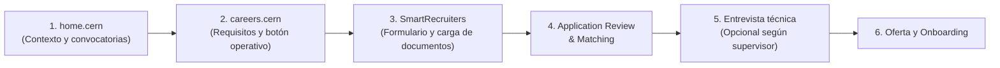

# Guía Estratégica Operativa: Postulación al CERN Summer Student Programme & OpenLab

Documento de referencia interna que consolida las directivas, cronograma oficial, requisitos técnicos, presupuesto de viáticos y criterios de selección del **CERN Summer Student Programme 2027**, extraído de las sesiones guiadas del programa y de la reunión informativa con la dirección del Departamento de Ciencias de la Computación de la Universidad de las Fuerzas Armadas – ESPE (Ing. Tatiana Gualotuña y equipo coordinador).

---

## 1. Plataformas y Ruta Oficial de Postulación

El proceso de postulación se realiza de forma estrictamente individual a través de las plataformas oficiales del CERN. **No se debe ingresar a formularios de terceros ni enlaces no verificados.**



### Enlaces Operativos Directos
* **Portal General de Carreras CERN:** [https://careers.cern/programmes/summer-studentship/](https://careers.cern/programmes/summer-studentship/)
* **CERN OpenLab Summer Student Programme:** [https://openlab.cern/cern-openlab-summer-student-programme/](https://openlab.cern/cern-openlab-summer-student-programme/)
* **Plataforma de Recepción SmartRecruiters:** [https://jobs.smartrecruiters.com/](https://jobs.smartrecruiters.com/)

> [!IMPORTANT]
> **Estrategia de Doble Postulación:**  
> Como estudiante de Tecnologías de la Información, puedes y debes postular a **ambos programas en paralelo**:
> 1. **CERN Summer Student Programme (General):** Abarca proyectos de física de datos, análisis cinemático, infraestructura y computación científica.
> 2. **CERN OpenLab:** Enfocado exclusivamente en estudiantes con perfil potente en programación, ciencias de la computación, arquitectura de software, IA y sistemas distribuidos.  
> Postular a las dos vías duplica las probabilidades de ser seleccionado.

---

## 2. Cronograma Crítico y Fechas Clave (Convocatoria 2026 – 2027)

| Fecha / Periodo | Hito Operativo | Acción Requerida |
| :--- | :--- | :--- |
| **10 de noviembre de 2026** | **Apertura oficial de la convocatoria** | Estar atentos desde el 5 de noviembre (en ocasiones puede retrasarse 1-2 semanas). |
| **Noviembre – Enero 2027** | **Revisión y consolidación de expediente** | Revisión presencial de documentos con la Ing. Tatiana Gualotuña en los laboratorios de la ESPE. |
| **26 al 28 de enero de 2027** | **Cierre definitivo de postulaciones** | Límite improrrogable para enviar el formulario en SmartRecruiters. |
| **26 al 28 de enero de 2027** | **Comité de Selección Inicial** | Validación formal de elegibilidad administrativa. |
| **Marzo – Abril de 2027** | **Matching y Ofertas Oficiales** | Los supervisores seleccionan candidatos y emiten las cartas de oferta. |
| **9 al 30 de junio de 2027** | **Llegada al CERN (Ginebra, Suiza)** | Planificar llegada en **domingo** para asistir desde el lunes a las conferencias magistrales. |

---

## 3. Condiciones Específicas para Ecuador (Estado No Miembro / NMS)

* **Duración de la estancia:** Como ciudadano ecuatoriano (Estado No Miembro del CERN), la estancia es de **exactamente 8 semanas (2 meses)**, a diferencia de los estados miembros que pueden permanecer hasta 16 semanas.
  * *(Excepción: Si el estudiante cuenta con doble nacionalidad con un estado miembro del CERN, se recomienda postular con dicha nacionalidad para acceder al periodo extendido).*
* **Formulario SmartRecruiters:** En la sección donde solicita el país de estudio o nacionalidad, si Ecuador no figura en la lista desplegable inicial, se debe marcar expresamente la opción **"Other"**.

---

## 4. Desglose Financiero, Viáticos y Logística Diaria

El programa del CERN otorga un estipendio de manutención diseñado para cubrir la vida en Ginebra sin costo para el estudiante:

* **Subsidio Diario:** **93 CHF diarios** (~$100 USD/día).
* **Alojamiento (Hostales oficiales del CERN):**
  * Costo: **50 CHF/día** (descontados del subsidio o pagados directamente).
  * **Saldo Neto Disponible:** **43 CHF netos/día** (~$48 USD/día) para alimentación y transporte.
* **Alimentación y Ahorro:**
  * Las habitaciones en los hostales del CERN disponen de **cocina equipada**. Comprar víveres en supermercados (o cruzar la frontera francesa contigua para comprar en euros) permite gastar entre 10 y 15 CHF diarios, permitiendo un ahorro neto al final de la estancia.
  * Comer en las cafeterías/restaurantes internos del CERN cuesta entre 20 y 30 CHF diarios.
* **Pasajes Aéreos:**
  * El CERN reembolsa el costo de un pasaje aéreo ida y vuelta en clase económica (Quito/Guayaquil – Ginebra) calculado bajo una estimación estándar al finalizar el programa.
  * *Recomendación:* Adquirir el pasaje con suficiente anticipación tras recibir la carta de oferta para optimizar el reembolso.
* **Movilidad Interna en el Campus:**
  * El campus del CERN dispone de servicio de bicicletas de alquiler (15 minutos entre residencias e instalaciones) y transporte interno en autobús por 5 CHF.

---

## 5. Paquete de Documentos para SmartRecruiters

> [!CAUTION]
> **El envío es definitivo e irreversible:** Una vez presionado el botón `Submit` en SmartRecruiters, el sistema bloquea la edición del formulario. Todos los archivos deben estar revisados y listos antes de ingresar.

1. **Curriculum Vitae (en inglés):**
   * Formato técnico estándar (Europass o LaTeX, 1 a 2 páginas).
   * Enlaces directos y clicables al perfil de GitHub ([@Klopezxd](https://github.com/Klopezxd)) y a proyectos clave.
2. **Historial Académico (*Official Transcript*):**
   * Récord académico oficial de notas emitido por la ESPE, **traducido al inglés o francés**.
3. **Carta de Motivación (*Statement of Purpose*):**
   * **Límite técnico estricto:** Máximo **1440 caracteres** en el campo de texto del formulario (~200 a 230 palabras).
   * *Enfoque:* Cero relleno; explicar directamente qué sabes hacer, qué herramientas dominas (Linux, Docker, Python columnar, Uproot, C# AOT) y en qué tipo de proyectos puedes aportar valor inmediato.
4. **Cartas de Recomendación Académica:**
   * Se recomienda cargar **2 cartas de recomendación** suscritas por docentes o investigadores de la ESPE (ej. Ing. Tatiana Gualotuña y docentes del área de computación).
5. **Nivel de Idiomas:**
   * **Inglés:** Evaluación realista (B1/B2 certificado EF SET 57/100). No se exige subir certificado obligatorio en el formulario, pero la entrevista técnica y el trabajo diario se desarrollan 100% en inglés.
   * **Francés:** Nivel básico deseable para interacción cotidiana fuera del laboratorio.

---

## 6. La Regla de Oro del Matching: "Habilidad ≠ Evidencia"

El CERN no asigna plazas por notas académicas aisladas; el proceso se rige por un **emparejamiento (*matching*)** donde los supervisores de proyectos buscan perfiles que resuelvan problemas técnicos abiertos.

```text
┌─────────────────────────────────────────────────────────────────────────────────┐
│                     CRITERIO DE DECISIÓN DEL SUPERVISOR                         │
├────────────────────────────────┬────────────────────────────────────────────────┤
│ Lo que un candidato dice:      │ Lo que el CERN exige ver (Evidencia):          │
├────────────────────────────────┼────────────────────────────────────────────────┤
│ "Sé Python"                    │ Repositorio en GitHub, notebooks documentados, │
│                                │ análisis columnar con Uproot/Awkward.          │
├────────────────────────────────┼────────────────────────────────────────────────┤
│ "Sé Linux y Contenedores"      │ Dockerfiles funcionales, comandos en scripts   │
│                                │ bash, arquitectura en WSL2 / servidores VPS.    │
├────────────────────────────────┼────────────────────────────────────────────────┤
│ "Trabajo en equipo"            │ Pull Requests revisados, commits convencionales│
│                                │ y ramas en proyectos colaborativos.            │
├────────────────────────────────┼────────────────────────────────────────────────┤
│ "Tengo iniciativa"             │ Proyectos personales resueltos de punta a punta│
│                                │ (cern-preparation-program, linter NanoAOD).    │
└────────────────────────────────┴────────────────────────────────────────────────┘
```

### Los Activos de Klever López para el Matching
* **Proyecto 1 (`cern-preparation-program`):** Evidencia auditable de 10 semanas de preparación sistemática en CMS Open Data, análisis columnar, Docker y reproducible research.
* **Proyecto 2 (`nanoaod-schema-linter`):** Solución de ingeniería de software para validación estructural de contratos de datos ROOT NanoAOD sin depender de CMSSW.
* **Proyecto 3 (`vet-prescription-generator`):** C# .NET 10 Native AOT, SQLite en modo WAL, bajo consumo de memoria y arquitectura limpia.
* **Proyecto 4 (`whisperx-transcriptor`):** Inferencia desacoplada, cuantización INT8 y Dockerización.

---

## 7. Ecosistema de Apoyo Institucional (ESPE)

* **Dirección de Departamento:** Ing. Tatiana Gualotuña (Directora de Ciencias de la Computación) lidera la iniciativa con apoyo docente del Ing. Ángel Giovanni Cutco.
* **Acompañamiento presencial:** Se organizarán sesiones en laboratorios de la universidad para revisar individualmente el expediente antes del envío formal.
* **Laboratorios de Investigación ("La NASA" - Bloque H, último piso):**
  * *Laboratorio de Tecnologías Ubicuas (Smart Cities, IoT, Green Software)*
  * *Laboratorio de Ciberseguridad*
  * *Laboratorio de Cómputo de Alto Rendimiento (HPC)*  
  Oportunidad para articular proyectos de titulación y prácticas preprofesionales vinculadas a publicaciones científicas.
