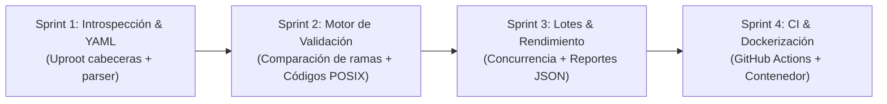

# Ejercicio 1 — Fundamentos Ágiles y Definición de Roadmap de Proyecto

* **Recursos de referencia:**
  * [Atlassian — Learn Agile Fundamentals](https://community.atlassian.com/learning/course/learn-agile-fundamentals)
  * [Atlassian — Project Roadmap](https://www.atlassian.com/es/agile/project-management/project-roadmap)
* **Fecha:** 12 de octubre de 2026
* **Estudiante:** Klever López (Ingeniería en Tecnologías de la Información)
* **Iniciativa:** Programa de Preparación para Oportunidades CERN (Semana 7)

---

## 1. Síntesis Técnica de los Recursos de Atlassian

### A. Gestión Ágil aplicada a Herramientas de Software Científico
* **Estructura del trabajo:** Descomposición jerárquica en Iniciativas, Épicas e Historias de Usuario / Tareas Técnicas. En herramientas de soporte e infraestructura (*developer tooling*) se integran **Spikes técnicos** (pruebas acotadas en tiempo) para validar mecanismos de I/O de bajo overhead (ej. comparar velocidad de introspección de cabeceras con `uproot` vs. lectura completa).
* **Priorización:** Criterios de balance entre valor y complejidad operativa (MoSCoW / WSJF). La prioridad es asegurar la fiabilidad en la detección de archivos corruptos y contratos de datos rotos antes de añadir formatos exóticos de exportación.
* **Seguimiento del progreso:** Uso de tableros Kanban con límites de trabajo en progreso (*WIP limits*) o tableros Scrum por iteraciones (*Sprints*), complementados con *Burndown Charts* y velocidad de entrega (*Velocity*).
* **Definición de Terminado (*Definition of Done - DoD*):** En herramientas CLI de aseguramiento de calidad de datos, el DoD exige: script ejecutable por terminal con códigos de retorno POSIX (`exit 0` / `exit 1`), pruebas con archivos corruptos simulados, imagen Docker ligera y documentación del formato de esquema YAML.

### B. Hoja de Ruta (*Project Roadmap*) vs. Plan de Proyecto (*Project Plan*)
* **Roadmap:** Herramienta visual y estratégica de alto nivel que comunica la visión, dirección, hitos y dependencias a interesados (*stakeholders*). No especifica tareas diarias ni micro-fechas.
* **Project Plan:** Desglose operativo detallado que gestiona la asignación granular de tareas, horas y flujos de trabajo en el corto plazo.

---

## 2. Borrador de Planificación: nanoaod-schema-linter

### 1. Nombre del Proyecto
`nanoaod-schema-linter: Validador de Esquemas e Integridad de Archivos ROOT para CMS Open Data`

### 2. Objetivo
Diseñar e implementar una herramienta de línea de comandos (CLI) ligera, rápida y reproducible en Python para validar la integridad estructural y la conformidad de esquemas de datos en archivos ROOT (formato NanoAOD) provenientes del portal CMS Open Data antes de su ejecución en pipelines de análisis, evitando interrupciones en tiempo de ejecución debidas a archivos corruptos, ramas faltantes o discrepancias de tipado.

### 3. Alcance (*Scope*)
* **Incluido (*In-Scope*):**
  * Introspección ultrarrápida de cabeceras de archivos ROOT con `uproot` sin cargar datos a memoria RAM.
  * Definición de esquemas declarativos en archivos YAML legibles por humanos (especificando ramas obligatorias y tipos de datos esperados).
  * Validación estructural defensiva: detección de archivos truncados, árboles sin eventos o cabeceras corruptas.
  * Reporte claro por consola con códigos de salida estándar POSIX (`0` = éxito, `1` = fallo de esquema, `2` = archivo corrupto) para integración en scripts de automatización.
  * Soporte de validación concurrente por lotes (*batch processing*) sobre directorios locales.
  * Empaquetado en contenedor Docker ultraligero (`python:3.11-slim`, < 200 MB).
* **Excluido (*Out-of-Scope*):**
  * Cálculos físicos, análisis cinemático o filtrado de partículas (la herramienta es estrictamente de validación de estructura de datos).
  * Interfaz gráfica de usuario (GUI) o dashboards web interactivos.
  * Reparación o reconstrucción automática de archivos binarios ROOT corruptos.
  * Soporte para formatos legados no tabulares anteriores a ROOT 6.

### 4. Hitos Principales (*Milestones*)
* **Hito 1 (Semana 1) — Introspección y Lector YAML:** Parser funcional que lee cabeceras ROOT en $< 0.5\text{ s}$ por archivo y carga el esquema declarativo YAML.
* **Hito 2 (Semana 2) — Motor de Validación y Códigos POSIX:** Algoritmo de comparación de conjuntos de ramas y validación de tipos `dtype`, emitiendo reportes en terminal y códigos de salida para pipelines.
* **Hito 3 (Semana 4) — Validación por Lotes, Docker y CI:** Procesamiento concurrente de carpetas con múltiples archivos, contenedor Docker optimizado y flujo de GitHub Actions con pruebas automáticas.

### 5. Asignación de Responsabilidades (Equipo de 3)
* **Klever López (Líder Técnico / Desarrollador de Software):**
  * Arquitectura del CLI en Python y manejo de argumentos de consola (`argparse`).
  * Integración con `uproot` para lectura de metadatos de bajo consumo de memoria.
  * Motor de comparación de esquemas y códigos de retorno POSIX.
  * Creación del Dockerfile reproducible.
* **Colaborador 1 (Analista de Datos / Usuario Científico):**
  * Redacción de los esquemas YAML oficiales para datasets de referencia de CMS (campañas 2012 y 2016).
  * Provisión de archivos de prueba reales (tanto válidos como deliberadamente alterados o corruptos).
* **Colaborador 2 (Ingeniero DevOps / QA):**
  * Automatización de pruebas unitarias con `pytest` en GitHub Actions.
  * Medición de tiempos de ejecución y pruebas de concurrencia en Linux y WSL2.

### 6. Gestión de Riesgos y Mitigación
* **Riesgo 1:** Lentitud o bloqueo de I/O al escanear directorios con cientos de archivos ROOT.
  * *Mitigación:* Validación concurrente con `concurrent.futures.ThreadPoolExecutor` y lectura restringida exclusivamente a metadatos de cabecera (`object_cache=None`).
* **Riesgo 2:** Variabilidad en los nombres y representaciones de tipos de datos en Uproot (`float32` vs. primitivos de C++).
  * *Mitigación:* Capa interna de normalización de tipos que mapea los tipos nativos de ROOT a tipos estándar de Python/NumPy antes de la comparación.
* **Riesgo 3:** Archivos incompletos o corruptos que interrumpan la ejecución global del lote con excepciones no controladas.
  * *Mitigación:* Manejo defensivo con `try/except` capturando errores de I/O y registrando el archivo como corrupto sin detener el análisis del resto del lote.

### 7. Roadmap Temporal (4 Sprints / Semanas)

